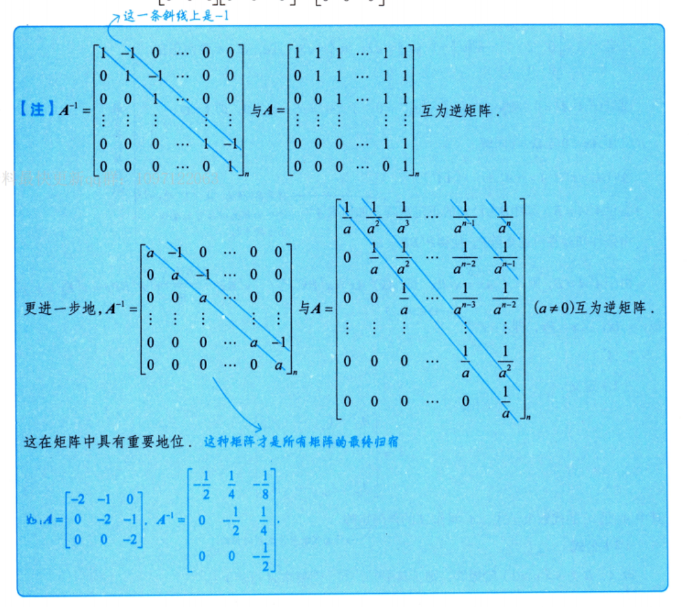

# 第2课｜矩阵幂的计算

> [!abstract] 本课目标
> 根据秩一结构、低次幂规律、可交换分解、初等变换或相似关系，把矩阵的高次幂化为可直接计算的形式。

## 一、先检查方阵与指数

**O：** 计算 $A^n$、$A^{-n}$，或含初等矩阵幂的乘积。

**P：** 先确认 $A$ 是方阵，再区分正整数次幂、零次幂与负整数次幂：

$$
A^n=\underbrace{AA\cdots A}_{n\text{ 个}},\qquad A^0=E,
$$

$$
\boxed{A^{-n}=(A^n)^{-1}=(A^{-1})^n,\qquad n\ge1,\ A\text{ 可逆}.}
$$

**D：**

- 矩阵的阶数与幂指数是两个不同概念；$m$ 阶方阵也可以求 $n$ 次幂。
- 负次幂不能用于不可逆矩阵。先算正次幂再求逆时，也要保证其可逆。
- 同一方阵的整数次幂可按指数运算；不同矩阵的乘积一般不能拆成 $(BC)^n=B^nC^n$。

## 二、秩一方阵：先分解为一列乘一行

**O：** $A$ 为方阵且 $r(A)=1$；具体矩阵的各行或各列成比例，且 $A\ne0$。

**P：**

1. 写成 $A=\alpha\beta^{\mathrm T}$，其中 $\alpha,\beta$ 是同维非零列向量。
2. 求中间的标量 $\beta^{\mathrm T}\alpha=\operatorname{tr}(A)$。
3. 直接调用

   $$
   \boxed{A^n=[\operatorname{tr}(A)]^{n-1}A,\qquad n\ge2.}
   $$

**D：**

- 分解后必须乘回原矩阵，不能只凭“比例看起来相同”选系数。
- 当 $\operatorname{tr}(A)=0$ 时，所有 $n\ge2$ 的幂均为零，但 $A$ 本身仍可非零。
- $n=1$ 直接取 $A$，避免在迹为零时使用 $0^0$；零次幂另取 $E$。
- 秩一结构一定给出 $A^2=kA$，其中 $k=\operatorname{tr}(A)$；反过来，满足 $A^2=kA$ 的矩阵不一定秩为1。

> [!example] 配套计算
> [[AI课程总结/强化篇/线代/第3讲 矩阵运算/例题#例 3.2 秩一方阵求十次幂|例 3.2：分解与迹]]

## 三、试算低次幂：找递推与周期

### 1. 先算平方，不够再算立方、四次幂

**O：** 求 $A^n$，但暂时看不出可直接调用的结构。

**P：** 依次试算 $A^2,A^3$，必要时算到 $A^4$；将各位置与原矩阵比较，寻找倍数关系、奇偶规律或系数规律。

| 试算得到的关系 | 可调用的幂公式 | 范围与检查 |
| --- | --- | --- |
| $A^2=kA$ | $A^n=k^{n-1}A$ | $n\ge2$；不要求秩1，$n=1$ 直接取 $A$ |
| $A^2=kE$ | $A^{2m}=k^mE$，$A^{2m+1}=k^mA$ | $m\ge1$；$A^0=E,A^1=A$ 单列 |
| $A^2=-E$ | $A^4=E$，指数可按模4化简 | 先确认四次幂是单位阵 |
| $A^3=kA$ | $A^{n+2}=kA^n$ | $n\ge1$；以 $A,A^2$ 为起点，分别递推奇偶次幂 |

若幂中出现系数 $1,3,6,\ldots$，检查是否对应

$$
\binom n2=\frac{n(n-1)}2,
$$

其中初始指数必须一起核对，不能仅凭前三个数猜定公式。

**D：**

- 试算用于发现规律；写出通项后，用递推或数学归纳法验证。
- $A^2=kA$ 中的 $k$ 只有在已经确认秩一等条件时，才可按相应依据取成迹。
- 比较整个矩阵的各位置，不只看主对角线；上三角阵右上角常同时含线性项与二次项。

> [!example] 配套推导
> [[AI课程总结/强化篇/线代/第3讲 矩阵运算/例题#例 3.3 试算上三角阵并验证通项|例 3.3：试算、系数规律与归纳]] · [[AI课程总结/强化篇/线代/第3讲 矩阵运算/例题#辅助例 9 平方为负单位阵时的周期|平方为负单位阵]]

### 2. 旋转矩阵：把幂解释为角度累加

**O：**

$$
A=R(\theta)=
\begin{pmatrix}
\cos\theta&-\sin\theta\\
\sin\theta&\cos\theta
\end{pmatrix}.
$$

**P：** $R(\theta)$ 作用于二维列向量时，使其绕原点逆时针旋转 $\theta$。重复作用即角度相加：

$$
\boxed{R(\theta)^n=R(n\theta),\qquad n\in\mathbb Z,}
$$

$$
R(\theta)^{-1}=R(-\theta)=R(\theta)^{\mathrm T}.
$$

若某个正整数 $q$ 满足 $q\theta=2\ell\pi$，其中 $\ell\in\mathbb Z$，则 $A^q=E$，可将整数指数按模 $q$ 化简。

**D：**

- 右上角为 $-\sin\theta$、左下角为 $\sin\theta$，决定这里的旋转方向。
- 旋转矩阵可逆，因此负指数也能按角度累加或周期化简。
- 周期来自旋转一整圈，不是任意正交矩阵都满足同一个周期。

> [!example] 配套计算
> [[AI课程总结/强化篇/线代/第3讲 矩阵运算/例题#例 3.4 旋转矩阵求负十一次幂|例 3.4：旋转角与负次幂]]

## 四、可交换分解：二项展开与幂零截断

**O：** $A$ 可写成 $B+C$，且 $BC=CB$；特别是 $A=E+N$，其中 $N$ 的低次幂为零。

**P：**

1. 分解矩阵，并检查 $BC=CB$；单位阵、数量阵与同阶矩阵都可交换。
2. 使用矩阵二项式：

   $$
   \boxed{A^n=\sum_{j=0}^{n}\binom nj B^{n-j}C^j,\qquad n\ge1.}
   $$

3. 如果某个低次幂为零，就截去后续项。常用情形为

   $$
   A=E+N,\quad N^3=0
   \quad\Longrightarrow\quad
   \boxed{A^n=E+nN+\frac{n(n-1)}2N^2,\quad n\ge2.}
   $$

   更一般地，若 $N^s=0$，只保留 $N^0,\ldots,N^{s-1}$ 中指数不超过 $n$ 的项。

若分解满足更强的条件 $BC=CB=0$，则

$$
\boxed{(B+C)^n=B^n+C^n,\qquad n\ge1.}
$$

**D：**

- 仅有 $A=B+C$ 不足以按普通二项式展开，必须核对可交换条件。
- 去掉主对角线的1后，剩下的矩阵不一定平方就为零；要实际计算 $N^2,N^3$。
- $BC=0$ 不能自动推出 $CB=0$；混合项全部消失须检查两个方向。
- 不可对角化的矩阵仍然能求幂；此时可交换分解与幂零截断往往更合适。

> [!example] 配套推导
> [[AI课程总结/强化篇/线代/第3讲 矩阵运算/例题#例 3.5 单位阵加幂零矩阵|例 3.5：二项展开只剩三项]]

## 五、初等矩阵幂：左行右列、重复与逆操作

**O：** 求 $P_1^mAP_2^n$，其中 $P_1,P_2$ 为初等矩阵，或指数中包含负整数。

**P：**

1. 从单位阵如何变成 $P_1,P_2$，识别对应的初等变换。
2. 左乘 $P_1^m$：对 $A$ 重复对应的行变换 $m$ 次。
3. 右乘 $P_2^n$：对结果重复对应的列变换 $n$ 次。
4. 负次幂改为逆变换；交换型先按奇偶性化简。

| 初等变换类型 | 重复 $m$ 次的效果（$m\ge1$） | 逆操作 |
| --- | --- | --- |
| 交换两行或两列 | 奇数次交换，偶数次不变；$P^2=E$ | 再交换一次，$P^{-1}=P$ |
| 某行或列乘 $c\ne0$ | 乘 $c^m$ | 乘 $1/c$ |
| 将另一行或列的 $c$ 倍加到目标行或列 | 加 $mc$ 倍，作为来源的行或列保持不变 | 改加 $-c$ 倍 |

**D：**

- 左乘对应行变换，右乘对应列变换；应按实际乘法位置判断。
- 倍加型的“系数乘次数”依赖重复同一个操作，且来源行或列不被该操作改变。
- 初等矩阵都可逆。含负指数时，不要把负号当成“将整个矩阵乘负数”。
- 若出现初等矩阵的转置，先识别转置后的矩阵对应什么操作，再判断左右乘的位置。

> [!example] 配套计算
> [[AI课程总结/强化篇/线代/第3讲 矩阵运算/例题#例 3.6 初等矩阵幂的行列变换|例 3.6：重复倍加与交换列]]

## 六、相似求幂：化到易求幂的矩阵

**O：** $P^{-1}AP=D$，其中 $P$ 可逆；或已知关系可凑成 $A=PDP^{-1}$。

**P：** 先反解 $A$，再保留两端的互逆矩阵，只对中间矩阵求幂：

$$
\boxed{A=PDP^{-1}\quad\Longrightarrow\quad A^n=PD^nP^{-1},\qquad n\ge1.}
$$

若 $D=\Lambda=\operatorname{diag}(\lambda_1,\ldots,\lambda_m)$，则

$$
\Lambda^n=\operatorname{diag}(\lambda_1^n,\ldots,\lambda_m^n).
$$

从矩阵方程凑相似形式时，常用

$$
AB=B^2-BC=B(B-C),\quad B\text{ 可逆}
\quad\Longrightarrow\quad
\boxed{A=B(B-C)B^{-1}.}
$$

**D：**

- 由 $AB=BD$ 解 $A$，应在两边**右乘** $B^{-1}$，不能改成左乘。
- 一般相似关系不要求 $D$ 是对角阵；关键是 $D^n$ 比 $A^n$ 易算。
- 只有确认 $A$ 可相似对角化，才能寻找对角阵 $\Lambda$；$m$ 阶矩阵需要 $m$ 个线性无关的特征向量。
- $A^n=PD^nP^{-1}$ 的次序固定，不能将 $P,P^{-1}$ 分别取 $n$ 次幂。
- 若 $n<0$，还需 $A$（等价地 $D$）可逆；对角情形要求所有 $\lambda_i\ne0$。

> [!example] 配套计算
> [[AI课程总结/强化篇/线代/第3讲 矩阵运算/例题#例 3.7 从矩阵方程凑相似形式|例 3.7：先提因子，再右乘逆矩阵]]

## 七、特殊上三角阵：快速写逆矩阵

**O：** 主对角线及其上方全为1的上三角阵；或主对角线全为 $a\ne0$、紧邻主对角线的上方全为 $-1$、其余元素为0的矩阵。

**P：** 令 $S$ 为 $m$ 阶矩阵，仅 $(i,i+1)$ 位置为1，其余为0，则 $S^m=0$。

主对角线及其上方全为1的矩阵为

$$
U=E+S+S^2+\cdots+S^{m-1},\qquad
\boxed{U^{-1}=E-S.}
$$

对 $T=aE-S$，

$$
\boxed{T^{-1}=\frac1aE+\frac1{a^2}S+\cdots+\frac1{a^m}S^{m-1},\qquad a\ne0.}
$$

也就是

$$
(T^{-1})_{ij}=
\begin{cases}
a^{-(j-i+1)},&i\le j,\\
0,&i>j.
\end{cases}
$$

**D：**

- $U^{-1}$ 的主对角线是1，紧邻其上方的一条斜线是 $-1$，更上方全为0。
- $T^{-1}$ 的主对角线是 $1/a$，向右每移一格，分母多一个 $a$；负 $a$ 时须检查符号交替。
- “上方全为1”与“只有紧邻主对角线的上方为 $-1$”是互逆结构中的两个不同矩阵，不能混记。
- 公式依赖指定的上三角结构及 $a\ne0$，不能推广到任意上三角阵。

> [!example] 配套推导
> [[AI课程总结/强化篇/线代/第3讲 矩阵运算/例题#例 3.7 从矩阵方程凑相似形式|全1上三角阵的逆]] · [[AI课程总结/强化篇/线代/第3讲 矩阵运算/例题#辅助例 10 上双对角阵的逆与负参数|通式推导与负参数]]

## 八、考场自查

- [ ] 是否先确认方阵，负指数是否先确认可逆？
- [ ] 秩一时是否先算迹；一般 $A^2=kA$ 是否避免反推秩1？
- [ ] 试算发现的规律是否用递推验证，是否检查了右上角等全部位置？
- [ ] 二项展开前是否检查 $BC=CB$，截断前是否实际确认幂零？
- [ ] 初等矩阵是否分清左行右列、奇偶次数与逆操作？
- [ ] 相似形式的两端是否互逆，中间矩阵是否真的易求幂？
