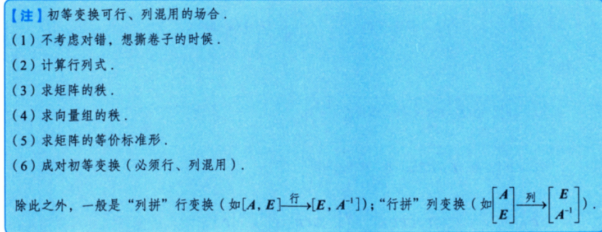

# 第4课｜可逆条件、初等变换与满秩分解

> [!abstract] 本课目标
> 用可逆性贯通各章等价条件，按目标选择初等变换，并通过矩阵分解降低计算阶数。

## 一、可逆的充要条件：以可逆性作桥梁

**O：** 判断 $n$ 阶方阵 $A$ 是否可逆，或判断下列不同表述是否等价。

**P：** 先把题设翻译成 $A$ 可逆，再转成所求条件。下表每一项均与 $A$ 可逆等价；涉及正定性时，$A$ 为实方阵。

| 联系对象        | 与 $A$ 可逆等价的条件                                                                      | D：条件检查                                       |
| ----------- | ---------------------------------------------------------------------------------- | -------------------------------------------- |
| 定义          | 存在同阶方阵 $B$，使 $AB=BA=E$；或仅要求存在 $B$ 使 $AB=E$；或仅要求存在 $B$ 使 $BA=E$                     | 同阶方阵的一侧逆即可成为两侧逆                              |
| 行列式         | $\|A\|\ne0$                                                                        | 行列式为0即不可逆                                    |
| 初等变换        | 等价标准形为 $E$；可经初等行变换化为 $E$；可经初等列变换化为 $E$；可分解为若干初等矩阵的乘积                               | 后三项各自都是充要条件，无须同时要求                           |
| 秩           | $r(A)=n$                                                                           | 方阵的满秩                                        |
| 右乘保持秩       | 对任给 $C_{n\times s}$，$r(AC)=r(C)$；或对任给 $C_{n\times n}$，$r(AC)=r(C)$                 | 必须保留“任给”；$s$ 为正整数                            |
| 左乘保持秩       | 对任给 $C_{s\times n}$，$r(CA)=r(C)$；或对任给 $C_{n\times n}$，$r(CA)=r(C)$                 | 右乘要求 $C$ 有 $n$ 行，左乘要求 $C$ 有 $n$ 列            |
| 齐次方程组       | $Ax=0$ 只有零解                                                                        | 未知数有 $n$ 个                                   |
| 非齐次方程组      | 对任给 $\beta\in\mathbb R^n$，$Ax=\beta$ 有唯一解；或对任给 $\beta\in\mathbb R^n$，$Ax=\beta$ 有解 | “对任意右端都有解”与“对任意右端有唯一解”在方阵条件下等价               |
| 齐次矩阵方程      | 对任给正整数 $s$，$AX=0_{n\times s}$ 只有零矩阵解                                               | $X$ 的每一列分别满足齐次方程组                            |
| 非齐次矩阵方程     | 对任给 $C_{n\times s}$，$AX=C$ 有唯一解；或对任给 $C_{n\times s}$，$AX=C$ 有解                     | 可逐列理解；可逆时 $X=A^{-1}C$                        |
| 列向量组        | 列向量组线性无关；等价地，任一列都不能由其余列线性表示                                                        | “任一列”不能改成“存在一列”                              |
| 行向量组        | 行向量组线性无关；等价地，任一行都不能由其余行线性表示                                                        | 行、列的结论分别成立                                   |
| 基（数学一）      | 列向量组是 $\mathbb R^n$ 的一个基；行向量组是 $\mathbb R^n$ 的一个基                                  | 有 $n$ 个向量且线性无关                               |
| 特征值         | $0$ 不是 $A$ 的特征值                                                                    | $A$ 可逆不要求特征值都为正                              |
| Gram矩阵      | $A^{\mathrm T}A$ 正定；$AA^{\mathrm T}$ 正定                                            | $A$ 为实方阵；不能改成 $A$ 自身正定                       |
| Gram矩阵的正定判据 | $A^{\mathrm T}A$ 的特征值全为正；与 $E$ 合同；正惯性指数为 $n$；顺序主子式全为正                              | 四项分别等价于 $A^{\mathrm T}A$ 正定；“顺序主子式”不是任意挑几个子式 |

**D：**

- 核心前提是 **$A$ 为方阵**；矩形矩阵的列满秩、行满秩不能直接称为可逆。
- 一个指定的 $C$ 满足 $r(AC)=r(C)$，或一个指定的 $\beta$ 使 $Ax=\beta$ 有解，都不能据此推出可逆。
- 对固定的 $\beta$，若 $Ax=\beta$ 有**唯一解**，则方阵 $A$ 可逆；“有解”与“有唯一解”不能混写。
- 判断“任给 $C$ 均保持秩”的反向结论，可取 $C=E$，立即得到 $r(A)=n$。

## 二、多项式关系求逆：凑出乘积等于单位阵

**O：** 已知 $f(A)=0$，要求 $(A-aE)^{-1}$，或判断 $E\pm A$ 是否可逆。

**P：**

1. 对标量多项式作长除法或因式分解：$f(t)=(t-a)q(t)+f(a)$。
2. 代入 $A$，常数项乘 $E$，得到 $(A-aE)q(A)=-f(a)E$。
3. 若 $f(a)\ne0$，除以该非零常数，按逆矩阵定义读出
   $$
   \boxed{(A-aE)^{-1}=-\frac{q(A)}{f(a)}.}
   $$

对 $A^3=0$，可直接调用有限乘积恒等式：

$$
\boxed{(E-A)^{-1}=E+A+A^2,\qquad
(E+A)^{-1}=E-A+A^2.}
$$

也可从 $f(A)=0$ 联想到特征值满足 $f(\lambda)=0$；$A^3=0$ 时所有特征值均为0，故 $E\pm A$ 的特征值均为1，都可逆。

**D：**

- 不能预先假设所求矩阵可逆，再用它的逆进行变形；先构造乘积等于 $E$。
- 若 $f(a)=0$，这次长除法不能给出逆，但不能仅据此判定 $A-aE$ 不可逆。
- $A^3=0$ 不等于 $A=0$，也不等于 $A$ 可逆；可逆的是这里的 $E\pm A$。

> [!example] 配套计算
> [[AI课程总结/强化篇/线代/第3讲 矩阵运算/例题#例 3.12 多项式长除法求逆|例 3.12：凑非零常数倍单位阵]] · [[AI课程总结/强化篇/线代/第3讲 矩阵运算/例题#例 3.14 幂零矩阵与单位阵之和、差|例 3.14：定义法与特征值法]]

## 三、数量阵扰动秩一结构：先补回，再设系数

**O：** 矩阵主对角元相同、非对角元也相同，或通过加减数量阵可恢复每行成比例的秩一结构；特别是主对角元为0、其余元为1。

**P：**

1. 观察能否写成秩一矩阵 $R=\alpha\beta^{\mathrm T}$ 与数量阵之和或差。
2. 调用 $R^2=(\beta^{\mathrm T}\alpha)R=\operatorname{tr}(R)R$。
3. 把待求逆设成 $uR+vE$，乘回后令 $R$ 的系数为0、$E$ 的系数为1，求出 $u,v$。

全1矩阵 $J=\alpha\alpha^{\mathrm T}$，其中 $\alpha=(1,\ldots,1)^{\mathrm T}$，满足 $J^2=nJ$。

**D：** 先补回数量阵，是为了显露秩一结构；不能把 $J-E$ 仍当作秩一矩阵。解系数时出现的分母必须非零，最后乘回检验。

> [!example] 配套计算
> [[AI课程总结/强化篇/线代/第3讲 矩阵运算/例题#例 3.13 主对角为零、其余为一的矩阵求逆|例 3.13：先加单位阵，再设待定系数]]

## 四、初等矩阵：左行右列，伴随反转次序

**O：** 已知 $A$ 经某种行、列变换得到 $B$，求行列式、逆矩阵或伴随之间的关系。

**P：** 先把操作写成左乘或右乘初等矩阵。记 $E_{ij}$ 为互换型，$E_{ij}(k)=E+ke_{ij}$ 为倍加型（$i\ne j$），$E_i(k)$ 为倍乘型（$k\ne0$），其中 $e_{ij}$ 仅第 $(i,j)$ 元为1。

| 类型 | 行列式 | 转置 | 逆 | 伴随 |
| --- | --- | --- | --- | --- |
| 互换型 $E_{ij}$ | $-1$ | $E_{ij}$ | $E_{ij}$ | $-E_{ij}$ |
| 倍加型 $E_{ij}(k)$ | $1$ | $E_{ji}(k)$ | $E_{ij}(-k)$ | $E_{ij}(-k)$ |
| 倍乘型 $E_i(k)$ | $k$ | $E_i(k)$ | $E_i(1/k)$ | $kE_i(1/k)$ |

乘法位置决定操作：

- 左乘 $E_{ij}(k)$：把第 $j$ 行的 $k$ 倍加到第 $i$ 行。
- 右乘 $E_{ij}(k)$：把第 $i$ 列的 $k$ 倍加到第 $j$ 列。
- 左乘互换型、倍乘型分别换行、倍乘行；右乘分别换列、倍乘列。

要求伴随时，再用

$$
B=PA\Rightarrow B^*=A^*P^*,\qquad
B=AQ\Rightarrow B^*=Q^*A^*.
$$

**D：** 换行或换列使行列式变号；倍乘使行列式乘相应倍数；倍加不改变行列式。取伴随后乘法次序反转，原来的换列操作会在伴随中表现为换行，并须检查整体符号。

> [!example] 配套判断
> [[AI课程总结/强化篇/线代/第3讲 矩阵运算/例题#例 3.15 交换原矩阵的列后求伴随|例 3.15：换列转成伴随换行]]

## 五、初等变换的选择：横拼行变换，竖拼列变换

**O：** 求逆、解 $AX=B$ 或 $XA=B$，或已知相似关系反求矩阵及其幂。

**P：** 求逆与下列矩阵方程中，$A$ 为可逆方阵；两块必须同步作相同变换。

| 目标           | 拼接及变换                                                                                          | 读出结果               |
| ------------ | ---------------------------------------------------------------------------------------------- | ------------------ |
| 求 $A^{-1}$   | $(A\mid E)\xrightarrow{\text{行}}(E\mid A^{-1})$                                                | 右块为逆矩阵             |
| 求 $A^{-1}$   | $\begin{pmatrix}A\\E\end{pmatrix}\xrightarrow{\text{列}}\begin{pmatrix}E\\A^{-1}\end{pmatrix}$  | 下块为逆矩阵             |
| 解 $AX=B$     | $(A\mid B)\xrightarrow{\text{行}}(E\mid A^{-1}B)$                                               | $X=A^{-1}B$        |
| 解 $XA=B$     | $\begin{pmatrix}A\\B\end{pmatrix}\xrightarrow{\text{列}}\begin{pmatrix}E\\BA^{-1}\end{pmatrix}$ | $X=BA^{-1}$        |
| 解 $Ax=\beta$ | 对 $(A\mid\beta)$ 作行变换，化到行阶梯形或行最简形                                                              | 保持方程组的解，检查相容性与自由变量 |

已知 $P^{-1}AP=D$、$P$ 可逆，反求 $A^k$ 时，先改写为 $A^kP=PD^k$，再用

$$
\boxed{
\begin{pmatrix}P\\PD^k\end{pmatrix}
\xrightarrow{\text{列}}
\begin{pmatrix}E\\PD^kP^{-1}\end{pmatrix}
=\begin{pmatrix}E\\A^k\end{pmatrix}.}
$$

**D：**

- $X$ 在已知系数矩阵右边：横拼作行变换；$X$ 在左边：竖拼作列变换。
- 解 $Ax=\beta$ 不要求 $A$ 可逆，不能一律把左块化为 $E$。
- 求秩、求等价标准形可混用行列变换；算行列式也可混用，但要记录变号与倍乘系数。
- 解方程组或保留列向量间的原有表示关系时，不能随意加入列变换。
- 合同变换须成对配套，最终为 $C^{\mathrm T}AC$；不能任意混用行列变换后就称为合同。

> [!example] 配套计算
> [[AI课程总结/强化篇/线代/第3讲 矩阵运算/例题#例 3.16 竖拼列变换求九十九次幂|例 3.16：同步把上块化为单位阵]]

## 六、极大线性无关组：变换后找列，原矩阵中取列

**O：** 求列向量组的极大线性无关组、其余向量的线性表示；数学一中求向量空间的基与维数。

**P：**

1. 把列向量横拼为 $A=(\alpha_1,\ldots,\alpha_n)$，只作初等行变换，化为阶梯形。
2. 读出秩 $r$，选择 $r$ 个线性无关的列；主元列给出一种直接选择。
3. 按这些列的编号，返回**原矩阵**取出相应向量，作为极大线性无关组。
4. 在变换后的矩阵中求其余列的表示系数；同一组系数用于原列向量。

**D：**

- 初等行变换保持列向量间全部线性关系，但不保持各列的具体坐标。
- 极大线性无关组不一定唯一，也不一定非选主元列不可；若题目指定了无关列的顺序，必须按指定顺序写系数。
- 求行向量组的极大线性无关组，可对转置矩阵作同样处理。
- 数学一中，向量组张成空间的维数为 $r$，所取原向量构成该空间的一个基。

> [!example] 配套计算
> [[AI课程总结/强化篇/线代/第3讲 矩阵运算/例题#例 3.17 满秩分解与降阶求十次幂|例 3.17：按给定列顺序写坐标]]

## 七、等价标准形：同时记录左右变换矩阵

**O：** 已知 $A_{m\times n}$、$r(A)=r$，求等价标准形及可逆矩阵 $P,Q$，使 $PAQ=S$。

**P：**

1. 标准形为

   $$
   S=\begin{pmatrix}E_r&0_{r\times(n-r)}\\
   0_{(m-r)\times r}&0_{(m-r)\times(n-r)}\end{pmatrix}.
   $$

2. 构造记录矩阵 $\begin{pmatrix}A&E_m\\E_n&0_{n\times m}\end{pmatrix}$。
3. 只对**前 $m$ 行**作行变换，只对**前 $n$ 列**作列变换，把左上块化为 $S$：

   $$
   \boxed{\begin{pmatrix}A&E_m\\E_n&0\end{pmatrix}
   \longrightarrow\begin{pmatrix}S&P\\Q&0\end{pmatrix}.}
   $$

4. 读出 $P_{m\times m}$、$Q_{n\times n}$，得到 $PAQ=S$，即

   $$
   \boxed{A=P^{-1}SQ^{-1}.}
   $$

**D：**

- $S$ 与 $A$ 同为 $m\times n$，$P,Q$ 的阶数分别为 $m,n$。
- 操作前 $m$ 行时，同步更新右上块；操作前 $n$ 列时，同步更新左下块，不能对整个记录矩阵任意操作。
- 标准形只由形状与秩决定；$P,Q$ 一般不唯一。等价不等于相似或合同。

> [!example] 配套理解
> [[AI课程总结/强化篇/线代/第3讲 矩阵运算/例题#辅助例 13 五阶秩二矩阵的等价标准形|五阶、秩二时怎样写标准形]]

## 八、满秩分解：一列满秩矩阵乘一行满秩矩阵

### 1. 两种分解程序

**O：** 对非零 $A_{m\times n}$、$r(A)=r$，求满秩分解 $A=BC$。

**P：**

- **从等价标准形分解：** 若 $PAQ=S$，则

  $$
  A=\underbrace{P^{-1}\begin{pmatrix}E_r\\0\end{pmatrix}}_{B_{m\times r}}
  \underbrace{\begin{pmatrix}E_r&0\end{pmatrix}Q^{-1}}_{C_{r\times n}}.
  $$

- **从列向量的极大线性无关组分解：** 选取原矩阵的 $r$ 个无关列，按约定顺序组成 $B$；把 $A$ 的每一列相对于这组列的表示系数依次写成 $C$ 的各列，即得 $A=BC$。

**D：**

- $r(B)=r(C)=r$；$B$ **列满秩**，$C$ **行满秩**，一般都不是方阵，不能写 $B^{-1}$、$C^{-1}$。
- 换一组无关列或换其顺序，会改变分解；固定列满秩的 $B$ 后，每列的表示系数唯一。
- 列满秩特例：$r(A)=n$ 时，存在可逆 $U_{m\times m}$，使 $A=U\begin{pmatrix}E_n\\0\end{pmatrix}$。
- 行满秩特例：$r(A)=m$ 时，存在可逆 $V_{n\times n}$，使 $A=\begin{pmatrix}E_m&0\end{pmatrix}V$。

### 2. 方阵降阶求幂

**O：** $A$ 为 $n$ 阶方阵，已知 $A=BC$，其中 $B$ 为 $n\times r$、$C$ 为 $r\times n$，且 $r<n$；求 $A^k$。

**P：** 先算低阶方阵 $D=CB$，再调用

$$
\boxed{A^k=B(CB)^{k-1}C=BD^{k-1}C,\qquad k\ge1.}
$$

若 $D$ 可对角化，写成 $D=T\Lambda T^{-1}$，求 $D^{k-1}=T\Lambda^{k-1}T^{-1}$，最后乘回 $B,C$。

**D：** 降阶的是 **$CB$**，不是原来的 $BC$；指数是 **$k-1$**。$k=1$ 时 $D^0=E_r$。该求幂恒等式只需 $A=BC$，不要求 $B,C$ 满秩；是否能够对角化须单独检查。

> [!example] 配套计算
> [[AI课程总结/强化篇/线代/第3讲 矩阵运算/例题#例 3.17 满秩分解与降阶求十次幂|例 3.17：四阶十次幂转成二阶九次幂]]

**初等行变换可行、列混用的场合：**

## 九、考场自查

- [ ] 可逆判据是否保留方阵、“任给”、唯一解等关键条件？
- [ ] 多项式常数项是否写成常数乘 $E$，除数是否非零？
- [ ] 初等矩阵是否左行右列，取伴随是否反转次序并保留符号？
- [ ] 横拼是否作行变换，竖拼是否作列变换，各块是否同步？
- [ ] 极大无关组是否从原矩阵取列，系数顺序是否与 $B$ 一致？
- [ ] 满秩分解的维数是否正确，降阶求幂是否用了 $(CB)^{k-1}$？
