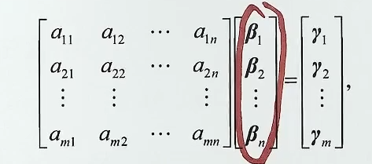
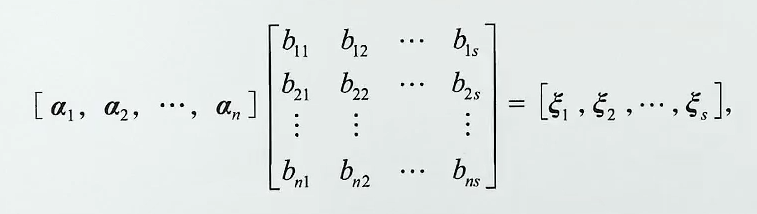

# 第5课｜分块矩阵与拼接求秩

> [!abstract] 本课目标
> 熟练完成分块运算与求逆，用乘积的行、列表示关系化零拼接矩阵，再判断秩与齐次方程组同解。

## 一、分块运算：先查尺寸，再守住次序

**O：** 把矩阵按行、按列或按若干子块处理，进行转置、加法、数乘、乘法。

**P：** 把子块视作整体，先检查分块是否匹配，再按对应运算处理。

- **行分块：** $A=\begin{pmatrix}A_1\\\vdots\\A_m\end{pmatrix}$，每个 $A_i$ 是原矩阵的一行。
- **列分块：** $B=(B_1,\ldots,B_n)$，每个 $B_j$ 是原矩阵的一列。
- **转置做两步：** 每个子块自身转置，再把子块的行、列位置互换：

  $$
  \boxed{\begin{pmatrix}A&B\\C&D\end{pmatrix}^{\mathrm T}
  =\begin{pmatrix}A^{\mathrm T}&C^{\mathrm T}\\B^{\mathrm T}&D^{\mathrm T}\end{pmatrix},
  \qquad (A,B)^{\mathrm T}=\begin{pmatrix}A^{\mathrm T}\\B^{\mathrm T}\end{pmatrix}.}
  $$

- **加法：** 同型且分法一致，对应子块相加。
- **数乘：** 系数乘到每一个子块上。
- **乘法：** 左矩阵的列分块尺寸与右矩阵的行分块尺寸对应一致，按“块行乘块列”计算：

  $$
  \boxed{\begin{pmatrix}A&B\\C&D\end{pmatrix}
  \begin{pmatrix}X&Y\\Z&W\end{pmatrix}
  =\begin{pmatrix}AX+BZ&AY+BW\\CX+DZ&CY+DW\end{pmatrix}.}
  $$

**D：**

- 整体可乘还不够；各块乘积和同一位置的相加也必须合法。例如 $AX$ 要求 $A$ 的列数等于 $X$ 的行数，$AX$ 与 $BZ$ 须同型。
- **左边的块仍在左边，右边的块仍在右边。** 一般不能把 $AX$ 改成 $XA$。
- 转置不能只换块的位置，也不能只给块添转置号。

## 二、分块求幂与求逆：先认主、副对角结构

### 1. 主对角块：逐块求幂、求逆

**O：** $M=\operatorname{diag}(A_1,\ldots,A_s)$，各 $A_i$ 均为方阵。

**P：** 对正整数 $k$，各块位置不变，分别处理：

$$
\boxed{M^k=\begin{pmatrix}
A_1^k&0&\cdots&0\\
0&A_2^k&\cdots&0\\
\vdots&\vdots&\ddots&\vdots\\
0&0&\cdots&A_s^k
\end{pmatrix},\qquad k\ge1.}
$$

若各 $A_i$ 可逆，则

$$
\boxed{M^{-1}=\begin{pmatrix}
A_1^{-1}&0&\cdots&0\\
0&A_2^{-1}&\cdots&0\\
\vdots&\vdots&\ddots&\vdots\\
0&0&\cdots&A_s^{-1}
\end{pmatrix}.}
$$

**D：** 各方块的阶数可以不同。零次幂为整体单位阵；负整数次幂须各块都可逆。不能把这一逐块求幂规则直接用于带有非零非对角块的矩阵。

### 2. 四种两块结构：左乘同行，右乘同列，再添负号

**O：** 主对角或副对角位置有两个可逆方块，其余位置中一个是零块、另一个为 $D$。

**P：** 设 $B,C$ 为可逆方阵，按结构直接调用：

$$
\boxed{\begin{pmatrix}B&0\\D&C\end{pmatrix}^{-1}
=\begin{pmatrix}B^{-1}&0\\-C^{-1}DB^{-1}&C^{-1}\end{pmatrix}.}
$$

$$
\boxed{\begin{pmatrix}B&D\\0&C\end{pmatrix}^{-1}
=\begin{pmatrix}B^{-1}&-B^{-1}DC^{-1}\\0&C^{-1}\end{pmatrix}.}
$$

$$
\boxed{\begin{pmatrix}0&B\\C&D\end{pmatrix}^{-1}
=\begin{pmatrix}-C^{-1}DB^{-1}&C^{-1}\\B^{-1}&0\end{pmatrix}.}
$$

$$
\boxed{\begin{pmatrix}D&B\\C&0\end{pmatrix}^{-1}
=\begin{pmatrix}0&C^{-1}\\B^{-1}&-B^{-1}DC^{-1}\end{pmatrix}.}
$$
$$
A=\begin{bmatrix}
0&\cdots&0&A_1\\
\vdots&&A_2&0\\
0&\dots&&\vdots\\
A_s&0&\cdots&0
\end{bmatrix}
\to A^{-1}=\begin{bmatrix}
0&\cdots&0&A_s^{-1}\\
\vdots&&A_{s-1}^{-1}&0\\
0&\dots&&\vdots\\
A_1^{-1}&0&\cdots&0
\end{bmatrix}
$$

记忆程序： #熟记 

1. **主对角型：** $B,C$ 各自求逆，位置不变；$D$ 与零块的位置不变。
2. **副对角型：** $B,C$ 求逆后交换位置，$D$ 与零块也交换位置。
3. 在逆矩阵的布局中，对 $D$ 所在位置，**左乘同行的逆块，右乘同列的逆块，再添负号**。
4. 乘回原矩阵，检查对角块为单位阵、其余块为零。

**D：**

- 口诀中的“同行、同列”按**求逆并换位后的布局**判断。
- $D$ 不要求可逆；它的尺寸由所在位置决定。主对角下三角型中，若 $B$ 为 $r$ 阶、$C$ 为 $s$ 阶，则 $D$ 为 $s\times r$。
- 副对角型若两可逆块阶数不同，逆矩阵的行分块尺寸对应原矩阵的列分块尺寸，列分块尺寸对应原矩阵的行分块尺寸；不能把每个格子的尺寸机械保留。

### 3. 多块副对角阵：求逆后反序排列

**O：** $M$ 的非零块仅在副对角线上，按从右上到左下的顺序为 $A_1,\ldots,A_s$，各块均为可逆方阵。

**P：** 逆矩阵仍仅在副对角线上有非零块；按从右上到左下的顺序改为

$$
\boxed{A_s^{-1},A_{s-1}^{-1},\ldots,A_1^{-1}.}
$$

**D：** 主对角型求逆不换位置，副对角型必须反序。若各块阶数不同，还要随反序调整分块尺寸。

## 三、零乘积：把右矩阵的列看成齐次方程组的解

**O：** $A_{m\times n}B_{n\times s}=0$，要求两矩阵的秩关系。

**P：** 把 $B=(\beta_1,\ldots,\beta_s)$ 按列分块，则每个 $\beta_j$ 都满足 $A\beta_j=0$。调用

$$
\boxed{r(B)\le n-r(A),\qquad r(A)+r(B)\le n.}
$$

**D：**

- 右端的 $n$ 是乘积的**内侧维数**，即 $A$ 的列数、$B$ 的行数；不要求 $A,B$ 都是方阵。
- $B$ 的列只保证是 $Ax=0$ 的若干解，未必张成全部解空间，因此一般只能得到不等式。
- $AB=0$ 不能直接推出 $A=0$ 或 $B=0$。

> [!example] 配套理解
> [[AI课程总结/强化篇/线代/第3讲 矩阵运算/例题#辅助例 14 零乘积与解空间维数|从解向量得到秩上界]]

## 四、乘积的行与列：行看右边，列看左边

**O：** $A_{m\times n}B_{n\times s}=C_{m\times s}$，研究 $C$ 的行、列如何表示。

**P：**

- 把 $B,C$ 按行分块，$A$ 的元素作系数。若 $B$ 的行为 $\beta_1,\ldots,\beta_n$，则 $C$ 第 $i$ 行为
  $$
  \gamma_i=\sum_{j=1}^n a_{ij}\beta_j.
  $$

- 把 $A,C$ 按列分块，$B$ 的元素作系数。若 $A$ 的列为 $\alpha_1,\ldots,\alpha_n$，则 $C$ 第 $j$ 列为
  $$
  \xi_j=\sum_{i=1}^n b_{ij}\alpha_i.
  $$

直接记住：

$$
\boxed{AB\text{ 的行由 }B\text{ 的行表示；}\quad
AB\text{ 的列由 }A\text{ 的列表示。}}
$$

**D：** 这是单向的线性表示，不自动得到行、列向量组等价。它给出 $r(AB)\le\min\{r(A),r(B)\}$，却不能保证秩相等。

## 五、拼接求秩：**横拼左同多化零，竖拼右同多化零**

### 1. 横拼：用保留块的列消去多余列

**O：** 求 $r(A,AB)$、$r(AB,A)$，或某块的列能由另一个完整块的列表示。

**P：** 保留 $A$，通过列变换把 $AB$ 化零：

$$
(A,AB)\xrightarrow{\text{列}}(A,0),\qquad
(AB,A)\xrightarrow{\text{列}}(0,A).
$$

因此

$$
\boxed{r(A,AB)=r(AB,A)=r(A).}
$$

一般地，保留块为 $C$、另一块为 $CR$ 时，同样有 $r(C,CR)=r(C)$。

**D：** 横拼要求行数相同；“左同”指乘积的**左因子**相同。保留块不要求可逆，也不用除掉该块。

### 2. 竖拼：用保留块的行消去多余行

**O：** 求 $r\begin{pmatrix}AB\\B\end{pmatrix}$，或某块的行能由另一个完整块的行表示。

**P：** 保留 $B$，通过行变换把 $AB$ 化零：

$$
\begin{pmatrix}AB\\B\end{pmatrix}
\xrightarrow{\text{行}}
\begin{pmatrix}0\\B\end{pmatrix},\qquad
\begin{pmatrix}B\\AB\end{pmatrix}
\xrightarrow{\text{行}}
\begin{pmatrix}B\\0\end{pmatrix}.
$$

因此

$$
\boxed{r\begin{pmatrix}AB\\B\end{pmatrix}
=r\begin{pmatrix}B\\AB\end{pmatrix}=r(B).}
$$

一般地，保留块为 $C$、另一块为 $LC$ 时，同样有 $r\begin{pmatrix}LC\\C\end{pmatrix}=r(C)$。

**D：**

- 竖拼要求列数相同；“右同”指乘积的**右因子**相同。
- “多”按**能否由保留块线性表示**判断；不能只数有几个字母，也不能仅因两块有共同因子就随意消掉其中一块。
- 变换后的拼接矩阵与原矩阵等价、秩相同，通常并不是两个矩阵相等。
- 横拼的化零采用列变换，竖拼的化零采用行变换；不要与求逆时的“横拼行变换、竖拼列变换”混淆，两者目标不同。

> [!example] 配套判断
> [[AI课程总结/强化篇/线代/第3讲 矩阵运算/例题#例 3.18 横拼矩阵的秩与乘法次序|例 3.18：横拼化零与错误选项反例]] · [[AI课程总结/强化篇/线代/第3讲 矩阵运算/例题#辅助例 15 复合乘积先看完整保留块|多个因子时怎样识别保留块]]

## 六、Gram块：先换成等价行向量组，再判断拼接秩

**O：** 实矩阵 $A_{m\times n}$ 与 $B_{m\times s}$，求 $r\begin{pmatrix}A^{\mathrm T}A\\B^{\mathrm T}A\end{pmatrix}$。

**P：** 调用两条关系：

1. $A^{\mathrm T}A$ 的行向量组与 $A$ 的行向量组**等价**。
2. $B^{\mathrm T}A$ 的行向量都可由 $A$ 的行向量表示。

因此拼接后的行空间就是 $A$ 的行空间，直接得到

$$
\boxed{r\begin{pmatrix}A^{\mathrm T}A\\B^{\mathrm T}A\end{pmatrix}
=r\begin{pmatrix}A\\B^{\mathrm T}A\end{pmatrix}=r(A).}
$$

**D：**

- $A$ 为实矩阵；一般复矩阵不能直接套用这里的 $A^{\mathrm T}A$ 结论。
- 这里替换的是**行向量组的张成空间**，不是写 $A^{\mathrm T}A=A$。两者行数可能不同，不能一律写成同型矩阵间的初等行变换。
- 两个块的字母数相同，不代表口诀失效；先识别等价行空间，才是判断冗余块的依据。

> [!example] 配套理解
> [[AI课程总结/强化篇/线代/第3讲 矩阵运算/例题#辅助例 16 Gram行空间与竖拼秩|为何Gram块可以提供全部需要的行空间]]

## 七、同解判定：乘积关系已隐含第三个秩

**O：** 判断 $ABx=0$ 与 $Bx=0$ 是否同解，或判断 $r(AB)=r(B)$ 是什么条件。

**P：** 两个系数矩阵有相同列数；一般齐次方程组 $Ux=0$、$Vx=0$ 同解的判据是

$$
\boxed{r(U)=r(V)=r\begin{pmatrix}U\\V\end{pmatrix}.}
$$

对 $U=AB$、$V=B$，竖拼化零已经保证

$$
r\begin{pmatrix}AB\\B\end{pmatrix}=r(B).
$$

故只需再比较前两个秩：

$$
\boxed{ABx=0\text{ 与 }Bx=0\text{ 同解}
\quad\Longleftrightarrow\quad r(AB)=r(B).}
$$

**D：**

- 此处秩相等是**充要条件**，不能因题设只写了两个秩便误判为仅必要条件。
- 一般 $r(U)=r(V)$ 不足以推出同解；这里还利用了 $AB$ 的行由 $B$ 的行表示这一隐含关系。
- $Bx=0\Rightarrow ABx=0$ 总成立；同解要求反向也成立。秩相等不要求 $A$ 可逆。

> [!example] 配套理解
> [[AI课程总结/强化篇/线代/第3讲 矩阵运算/例题#辅助例 17 两个秩相等为何已是充要条件|解集包含关系与三秩判据]]

## 八、新的分块结构：调用整体公式或初等变换

**O：** 分块矩阵不能直接套用熟悉结构，或出现整体伴随矩阵。

**P：**

1. 先检查能否按前面的分块运算、求逆和行列表示关系处理。
2. 把分块矩阵作为一个整体，调用普通矩阵公式。若 $M$ 是方阵，

   $$
   \boxed{MM^*=M^*M=|M|E.}
   $$

3. 若结构仍不便处理，尝试初等变换化到熟悉结构，再完成目标。

**D：**

- $M^*$ 是**整个方阵**的伴随，不是给每个块分别取伴随后照原位置拼起来。
- $E$ 是整体阶数的单位阵，按分块写时对角位置的单位块须尺寸对应。
- 基本伴随恒等式不要求可逆；使用 $M^*=|M|M^{-1}$ 时才要求可逆。

## 九、考场自查

- [ ] 分块乘法的内侧尺寸是否对应，转置是否完成“两次转置”？
- [ ] 求逆时是否检查可逆块、乘法次序、副对角换位和负号？
- [ ] 零乘积秩上界中的 $n$ 是否取乘积的内侧维数？
- [ ] 横拼是否看列表示，竖拼是否看行表示，保留块是否完整存在？
- [ ] Gram替换是否依赖实数条件，是否只用于行空间与秩？
- [ ] 同解判定是否利用了第三个秩的隐含关系？
